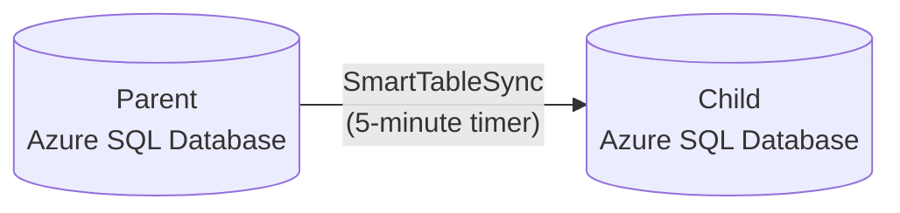
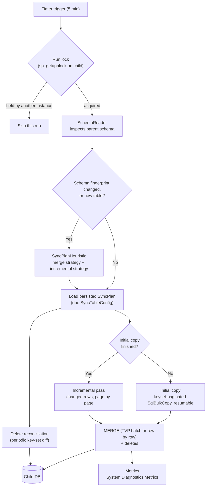

# SmartTableSync

A self-configuring .NET 10 engine that keeps tables synchronized between two Azure SQL databases
(parent → child): give it table names, and it inspects each table's schema, picks how to detect
changes and how to merge them, and keeps the child up to date every few minutes. It ships with an
Azure Functions host, but the engine is a plain library usable from any .NET host.

## The problem

Azure SQL Database doesn't support cross-database queries — you can't `JOIN` or even `SELECT`
across two separate Azure SQL databases in one query, unlike on-prem SQL Server or Azure SQL
Managed Instance. **Azure SQL Data Sync** is Microsoft's managed answer, but:

- It can't use an `nvarchar(max)` or `varbinary(max)` column as part of an **indexed key**.
- Each synced row must stay under a **24 MB batch limit**.
- It is being **retired on 30 September 2027**; Microsoft's migration guidance points to Azure
  Data Factory or Azure Functions — the shape of this project.

SmartTableSync started as the transport for the tables Data Sync can't handle and is growing into
a general replacement ([ADR-0013](docs/adr/0013-position-as-general-data-sync-replacement.md)).



## Why build it: the alternatives and their cost

It was built to solve a real production problem, and it runs in production. Microsoft's
[Data Sync migration guide](https://learn.microsoft.com/azure/azure-sql/database/sql-data-sync-retirement-migration)
lists the alternatives. None of them is a ready-made, table-level, one-way sync from one Azure SQL
Database into another that also keeps the child's own tables:

| Alternative | Why it doesn't fit this case | Cost |
|---|---|---|
| Transactional replication | Azure SQL Database can only be a subscriber, never the publisher | — |
| Read replicas, active geo-replication, database copy | Whole database only, read-only or a one-time snapshot; the child can't have its own tables | A full secondary database |
| Fabric mirroring | Replicates into OneLake as read-only Delta tables, not into another Azure SQL Database; needs a running Fabric capacity | F2 capacity ≈ **$320/month** |
| Azure Data Factory, incremental copy | Works, but every run is billed, and deletes and upserts need extra pipeline design | ≈ **$170 per table per month** at a 5-minute schedule |
| Azure Functions | Named in the guide, but you write the sync yourself | This project is that Function |

**Data Factory estimate**, per table, every 5 minutes (8,640 runs a month):

- Copy activity: at least 4 DIUs, billed per minute and rounded up, even when one row changed:
  4 DIU × 1 min × $0.25/DIU-hour ≈ $0.017 a run, so **≈ $144**.
- Orchestration: watermark lookup, copy and watermark update are 3 activity runs at $1 per 1,000,
  so **≈ $26**.
- That's ≈ **$170 per table**, ≈ **$1,700 a month for 10 tables**, before deletes are handled.

**SmartTableSync** syncs all tables in one Function run: 8,640 executions a month, which usually
stays inside the Azure Functions monthly free grant. What remains is the storage account and
logging, typically a few dollars a month.

Prices are Microsoft list prices from the
[Azure Retail Prices API](https://learn.microsoft.com/rest/api/cost-management/retail-prices/azure-retail-prices)
(West Europe, USD, pay-as-you-go, October 2026). The billing rules come from
[Data Factory DIUs](https://learn.microsoft.com/azure/data-factory/copy-activity-performance-features#data-integration-units),
[integration runtime charges](https://learn.microsoft.com/azure/data-factory/better-understand-different-integration-runtime-charges)
and [Fabric mirroring cost](https://learn.microsoft.com/fabric/mirroring/overview#cost-of-mirroring).
Check your own numbers in the [Azure pricing calculator](https://azure.microsoft.com/pricing/calculator/).

## How it works

Every run, for each configured table:



### Incremental strategies

How a table finds what changed since the last run. Chosen automatically per table — the first
applicable one in this order wins — or forced with `SmartTableSync:IncrementalStrategyOverrides:<Table>`:

| Strategy | Used when | Deletes |
|---|---|---|
| `SqlChangeTracking` | A DBA enabled SQL Server Change Tracking on the table | Reported directly, every run |
| `RowVersion` | The table has a `rowversion` column | Periodic reconciliation |
| `Timestamp` | The table has the configured datetime column (default `LastUpdate`) | Periodic reconciliation |
| `FullRescan` | None of the above, and the table is small (≤ 50,000 rows) or listed in `AllowFullRescanFor` | Periodic reconciliation |

A large table with no usable strategy fails at provisioning with a message naming the setting to
fix — it never silently re-scans millions of rows every five minutes.

### Merge strategies

- **TVP** — one stored-procedure call per batch, for tables that reference no other table and
  have small rows.
- **Row by row** — one call per row, so one failing row doesn't fail the batch: for tables that
  reference another table (a row can arrive before the row it references; the FK error is retried
  next run) or that have very large rows.

### Reliability

- Initial copy is keyset-paginated and resumable from the last completed batch.
- Incremental passes read changes in bounded pages, so a backlog after an outage never loads
  into memory at once.
- The position is only advanced after a pass succeeds; a retryable failure re-reads the window.
- Opening a connection retries transient Azure SQL errors with exponential backoff.
- An application lock in the child database guarantees one run at a time across every host
  instance; SQL Server releases it automatically if a host dies.

## Configuration

Connection strings: `ParentDbConnectionString`, `ChildDbConnectionString`, and — only for Auto
mode — `ChildProvisioningConnectionString`. Engine settings (App Settings or `local.settings.json`;
see [`local.settings.template.json`](SmartTableSyncFunction/local.settings.template.json)):

| Setting | Default | Meaning |
|---|---|---|
| `SmartTableSync:TableList` | — (required) | Comma-separated tables to sync |
| `SmartTableSync:Mode` | `Manual` | `Auto` lets the engine create child tables/types/procedures itself |
| `SmartTableSync:TimestampColumns:<Table>` | `LastUpdate` | Datetime column for the Timestamp strategy (old name `ChangeTrackingColumns` still read) |
| `SmartTableSync:AllowFullRescanFor` | — | Large tables allowed to re-scan every run |
| `SmartTableSync:IncrementalStrategyOverrides:<Table>` | — | Force `Timestamp`, `RowVersion`, `FullRescan` or `SqlChangeTracking` |
| `SmartTableSync:ReconcileIntervalHours` | `1` | Delete-reconciliation interval for non Change Tracking tables |
| `SmartTableSync:ChangeTrackingReconcileIntervalHours` | `24` | Same for Change Tracking tables (`0` = only after a fallback re-scan) |
| `SmartTableSync:ConnectionOpenAttempts` | `5` | Attempts to open a connection on transient errors (1–60) |

Settings are validated at startup: an empty or duplicated table list stops the host from starting.

## Getting started

To see it run on Azure first, [`demo/`](demo/README.md) deploys a parent and a child database,
the Function and three demo tables to your own subscription with one script, then syncs them.

```bash
cd SmartTableSyncFunction
dotnet build
```

1. Set up the three database identities from [`sql/07_permissions.sql`](sql/07_permissions.sql)
   (runtime, parent introspection, child provisioning) — the always-on runtime never holds DDL rights.
2. Child tracking tables (`CustomSyncState`, `SyncBatchLog`, `SyncTableConfig`) are generated:
   **Auto mode** creates them on every run; in **Manual mode** run
   `smarttablesync-scaffold --infrastructure` once and apply `00_infrastructure.sql`.
3. Child business tables and their MERGE procedures: Auto mode creates them; in Manual mode run
   `smarttablesync-scaffold <Table> ...` and apply the generated scripts after review.
4. Optional, per table, applied by a DBA on the **parent**:
   `smarttablesync-scaffold --change-tracking-setup <Table>` (enables Change Tracking and grants
   `VIEW CHANGE TRACKING`) or `--rowversion-setup <Table>` (adds a rowversion column and index).
5. Configure the connection strings and `SmartTableSync:TableList`, then publish the Function.

To host the engine elsewhere, reference `SmartTableSync.Core`, call `services.AddSmartTableSync()`
and invoke `ISyncOrchestrator.RunAsync` on your own schedule. `ISyncRunLock`,
`IDbConnectionFactory` and `ISyncMetricsReporter` can be replaced by registering your own
implementation. Metrics use the `SmartTableSync` meter (`System.Diagnostics.Metrics`), so any
OpenTelemetry exporter can collect them.

To connect with Managed Identity or another Microsoft Entra method (`Authentication=Active
Directory ...` in the connection string), the host also needs the
`Microsoft.Data.SqlClient.Extensions.Azure` package, in the same version as
`Microsoft.Data.SqlClient`. Since SqlClient 7.0 those providers are no longer part of the core
package. SQL authentication doesn't need it.

## Project layout

| Project | What it is |
|---|---|
| `SmartTableSync.Core` | The engine (NuGet package `SmartTableSync`) |
| `SmartTableSyncFunction` | Thin Azure Functions host (timer trigger) |
| `SmartTableSync.Scaffold` | CLI (`dotnet tool`, `smarttablesync-scaffold`) that writes reviewable SQL; never executes DDL |
| `SmartTableSync.Tests` | Unit tests |
| `SmartTableSync.IntegrationTests` | Tests against a real, disposable SQL Server (Testcontainers; needs Docker) |
| `demo/` | Terraform, SQL and a script that deploy and run the whole setup on Azure |

Inside Core, each incremental strategy has its own folder under `Strategies/` holding the
strategy (when it applies, which column it reads) and its runner. Every runner derives from
`ChangeWindowSyncRunner<TPosition>` in `Strategies/Abstractions/`, which owns paging, deletes,
merging and the position rule — see
[ADR-0017](docs/adr/0017-strategy-registry-and-template-method-runners.md).

## Architecture decisions

Significant decisions — what was chosen, what was rejected, and why — are recorded as
[Architecture Decision Records](docs/adr/README.md).

## Status

Version **0.3.0**. The sync engine runs in production on Azure SQL Database with a deployed
Function App. Not yet published to NuGet.

0.3.0 is not drop-in compatible with 0.2.0 code that used engine types directly: the public API
is now only what a host needs (`AddSmartTableSync`, the settings types, `ISyncOrchestrator`, and
the replaceable services above). Hosts that only call `AddSmartTableSync()` are unaffected; the
`SmartTableSync:ChangeTrackingColumns` setting keeps working.

## License

Copyright 2026 Ruslan Sidoriako. Licensed under the [Apache License, Version 2.0](LICENSE).
Redistributions must keep the copyright and the [NOTICE](NOTICE) file, and modified files must
say they were changed.
