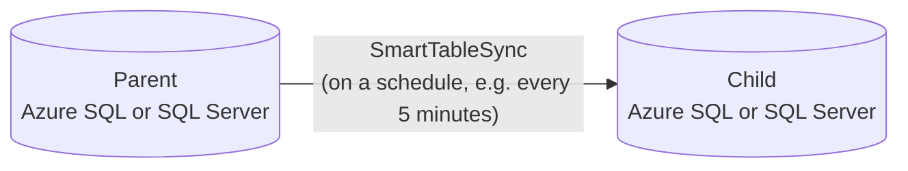
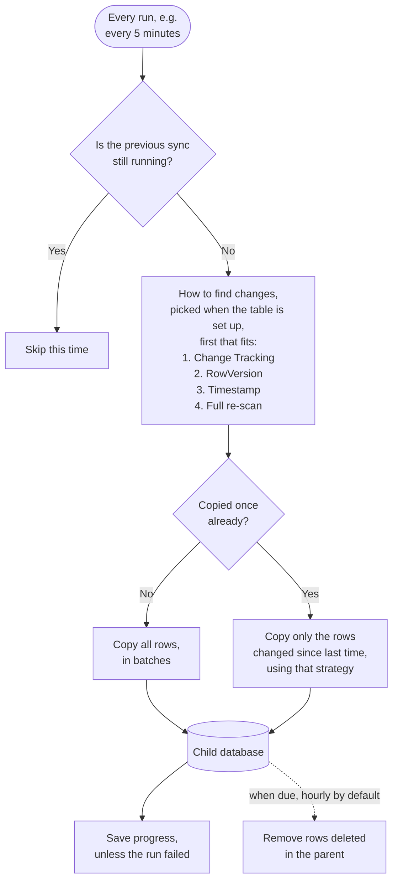

# SmartTableSync

A self-configuring .NET 10 engine that keeps tables synchronized from one SQL database to another
(parent → child): give it table names, and it inspects each table's schema, picks how to detect
changes and how to merge them, and keeps the child up to date on a schedule you choose. The engine
is a plain library usable from any .NET host; the repository includes an Azure Functions host as
a ready-to-use example.

It was built for **Azure SQL Database**, where it runs in production, but it isn't limited to
Azure: parent and child can each be Azure SQL Database, Azure SQL Managed Instance or SQL Server
(on-premises or in a VM), in any combination.

**What it does**

- Syncs the tables you list, one way, from the parent into the child: inserts, updates and deletes.
- Chooses per table how to find changed rows: SQL Server Change Tracking, a `rowversion` column,
  a timestamp column, or a full re-scan for small tables.
- Copies a new table in full once, then only what changed; resumes where it stopped after a
  failure.
- Runs with least privilege: the sync never has DDL rights, and signs in with managed identities
  or any other SQL Server sign-in.
- Notices schema changes in the parent, and in Auto mode adds new columns to the child by itself.

**New here?** Watch it work with the [one-script demo](demo/README.md), or start syncing your own
Azure SQL databases with the [quick start](quickstart/README.md). All the ways to set it up are
under [guides](#guides).

## The problem

Azure SQL Database doesn't support cross-database queries: you can't `JOIN` or even `SELECT`
across two separate Azure SQL databases in one query, unlike on-premises SQL Server or Azure SQL
Managed Instance. **Azure SQL Data Sync** is Microsoft's managed answer, but:

- It can't use an `nvarchar(max)` or `varbinary(max)` column as part of an **indexed key**.
- Each synced row must stay under a **24 MB batch limit**.
- It is being **retired on 30 September 2027**; Microsoft's migration guidance points to Azure
  Data Factory or Azure Functions, the shape of this project.

SmartTableSync started as the transport for the tables Data Sync can't handle and is growing into
a general replacement ([ADR-0013](docs/adr/0013-position-as-general-data-sync-replacement.md)).



## Why not the alternatives

Microsoft's
[Data Sync migration guide](https://learn.microsoft.com/azure/azure-sql/database/sql-data-sync-retirement-migration)
lists the alternatives. None of them is a ready-made, table-level, one-way sync from one Azure SQL
Database into another that also keeps the child's own tables:

| Alternative | Why it doesn't fit this case | Cost |
|---|---|---|
| Transactional replication | Azure SQL Database can only be a subscriber, never the publisher | — |
| Read replicas, active geo-replication, database copy | Whole database only, read-only or a one-time snapshot; the child can't have its own tables | A full secondary database |
| Fabric mirroring | Replicates into OneLake as read-only Delta tables, not into another Azure SQL Database | F2 capacity ≈ **$320/month** |
| Azure Data Factory, incremental copy | Works, but every run is billed, and deletes and upserts need extra pipeline design | ≈ **$170 per table per month** at a 5-minute schedule |
| Azure Functions | Named in the guide, but you write the sync yourself | This project is that sync, ready-made |

**SmartTableSync** syncs all tables in one run of its host: on Azure Functions that usually stays
inside the monthly free grant, leaving a few dollars a month for storage and logging. How these
numbers are calculated, with sources: [the alternatives and what they cost](docs/alternatives.md).

## How it works

On every run (as often as the host schedules it), for each table in the list:



**How changes are found.** Each table gets the first strategy that fits, in this order, chosen
automatically when the table is set up:

| Strategy | Used when | Deletes reach the child |
|---|---|---|
| [Change Tracking](docs/sync-strategies.md#sqlchangetracking) | SQL Server Change Tracking is on for the table | on every run |
| [RowVersion](docs/sync-strategies.md#rowversion) | the table has a `rowversion` column | at the delete check, hourly by default |
| [Timestamp](docs/sync-strategies.md#timestamp) | the table has a UTC datetime column updated on every change (default `LastUpdate`) | at the delete check |
| [Full re-scan](docs/sync-strategies.md#fullrescan) | none of the above, and the table has up to 50,000 rows | at the delete check |

A large table with no way to find changes stops at setup with a message saying what to fix; it
never silently re-reads millions of rows on every run.

**How rows are written.** The first copy uses bulk copy; later changes are merged in batches, or
row by row for tables that reference other tables or have very large rows. Every write is a
`MERGE`, so repeating one is harmless.

**When something fails.** A table that fails keeps its position and is retried from the same
place on the next run; the other tables carry on. One run at a time is guaranteed by a lock in the
child database, across every host instance.

More: [every step of a run in detail](docs/how-it-works.md) ·
[each strategy with a diagram](docs/sync-strategies.md)

## Where it runs

| | Supported |
|---|---|
| **Databases** | Azure SQL Database, Azure SQL Managed Instance, SQL Server on-premises or in a VM, in any mix (for example an on-premises parent and an Azure SQL child). SQL Server 2016 SP1 or later. |
| **Sign-in** | Whatever the connection string supports: managed identity or Microsoft Entra for Azure, SQL logins or Windows authentication on-premises. |
| **Host** | Any .NET app that calls `ISyncOrchestrator.RunAsync`, on Windows or Linux: an Azure Function (included as an example), a Linux container (image included), a background service, a Hangfire or Quartz.NET job, a Windows service. It only needs network access to both databases. |
| **Schedule** | Decided by the host: any interval, from every minute to once a night. The example Function runs every 5 minutes. |

## Guides

Pick the way you want to run it. Each guide is a step-by-step recipe with every command and
every SQL statement.

| I want to | Guide |
|---|---|
| **See it work** first: everything is created for me, with demo tables | [Run the demo](demo/README.md) (`./demo/run-demo.ps1 -Suffix <yours>`) |
| **Sync my own Azure SQL databases** with one script | [Quick start](quickstart/README.md) |
| Set it up by hand in **Manual mode**: scaffold tool, reviewed SQL, least rights (production) | [Manual mode, step by step](docs/guides/manual-mode.md) |
| Set it up by hand in **Auto mode**: the engine creates the child's tables | [Auto mode, step by step](docs/guides/auto-mode.md) |
| Run it in a **container** on Linux: Docker, Azure Container Apps, Kubernetes | [Run it in a container](docs/guides/containers.md) |
| Run it in **my own app**: a background service, Hangfire or Quartz.NET | [Run it in your own app](docs/guides/hosting.md) |

Reference:

| Topic | Page |
|---|---|
| Every setting, with examples | [Configuration reference](docs/configuration.md) |
| Why each identity needs each right; troubleshooting | [Setup guide](docs/setup.md) |
| How changes are found | [Sync strategies](docs/sync-strategies.md) |
| What happens in a run, merging, reliability | [How it works](docs/how-it-works.md) |
| Logs, metrics, Application Insights, Prometheus, Grafana | [Observability](docs/observability.md) |
| The scaffold tool's commands | [SmartTableSync.Scaffold](SmartTableSync.Scaffold/README.md) |
| Projects, code structure, architecture decisions | [Architecture](docs/architecture.md) |

## Manual or Auto mode

The child needs a table, a table type and a merge procedure for every synced table. The mode
decides who creates them:

| | **Manual** (default) | **Auto** |
|---|---|---|
| Who creates the child's objects | You: the scaffold tool writes the SQL, you review and apply it | The engine, the first time it sees a table |
| A new column in the parent | You apply the scaffold tool's `<Table>_AddColumns.sql` | Added by the engine on the next run |
| Rights of the host on the child | Data only, on the synced objects | Data on whole schemas, plus a second identity that can create objects |
| Best for | Production, where every schema change is reviewed | A child database used only by the sync; dev, test, getting started |

Changes that could lose data (a column's type, length or key) are never applied automatically in
either mode. Step by step: [Manual mode](docs/guides/manual-mode.md) ·
[Auto mode](docs/guides/auto-mode.md).

## Configuration

The settings every setup needs:

```json
{
  "ParentDbConnectionString": "Server=tcp:myserver.database.windows.net,1433;Database=ParentDb;Authentication=Active Directory Managed Identity;User Id=<client id>;Encrypt=True",
  "ChildDbConnectionString": "Server=tcp:myserver.database.windows.net,1433;Database=ChildDb;Authentication=Active Directory Managed Identity;User Id=<client id>;Encrypt=True",
  "SmartTableSync": {
    "TableList": "Product,Customer,sales.Order",
    "Mode": "Manual"
  }
}
```

Auto mode also needs `ChildProvisioningConnectionString`. Every other setting (timestamp column,
keys for tables without a primary key, strategy overrides, delete check interval, retries), with
examples: [configuration reference](docs/configuration.md).

To sign in with a managed identity or another Microsoft Entra method, the host needs the
`Microsoft.Data.SqlClient.Extensions.Azure` package; the example Function and the scaffold tool
have it.

## Known limitations

The main ones; the full list is on its own page, **[known limitations](docs/limitations.md)**:

- One-way only, parent → child; the child is a read-only copy.
- Every table needs a key (primary key, unique index, or `SmartTableSync:KeyColumns`); a table
  with possible duplicate rows can't be synced yet.
- Deletes reach the child on every run only with Change Tracking; with the other strategies, at
  the next delete check (hourly by default).
- Changes in the parent that could lose data (a column's type, length or key) need a reviewed
  script; the table stops until then.

## Roadmap

What's planned next, including an API and a web page to control the sync and a whole-table copy
for tables without any key, is in the **[roadmap](docs/roadmap.md)**.

## Status

Version **0.4.0**. The sync engine runs in production on Azure SQL Database with a deployed
Function App. Not yet published to NuGet. What changed in each version, and what to check when
upgrading, is in the [changelog](CHANGELOG.md).

## License

Copyright 2026 Ruslan Sidoriako. Licensed under the [Apache License, Version 2.0](LICENSE).
Redistributions must keep the copyright and the [NOTICE](NOTICE) file, and modified files must
say they were changed.
