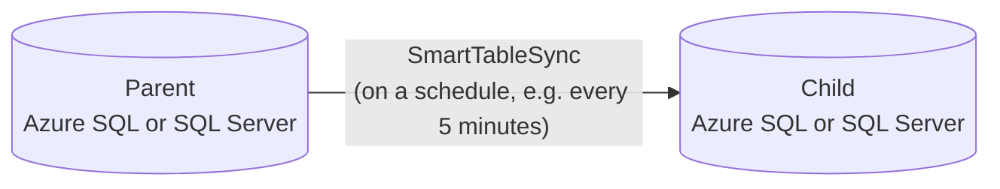
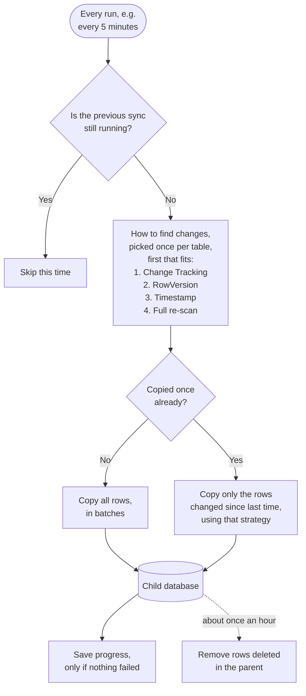

# SmartTableSync

A self-configuring .NET 10 engine that keeps tables synchronized from one SQL database to another
(parent → child): give it table names, and it inspects each table's schema, picks how to detect
changes and how to merge them, and keeps the child up to date on a schedule you choose. The engine
is a plain library usable from any .NET host; the repository includes an Azure Functions host as
a ready-to-use example.

It was built for **Azure SQL Database**, where it runs in production, but it isn't limited to
Azure: parent and child can each be Azure SQL Database, Azure SQL Managed Instance or SQL Server
(on-premises or in a VM), in any combination. See [where it runs](#where-it-runs).

## The problem

Azure SQL Database doesn't support cross-database queries — you can't `JOIN` or even `SELECT`
across two separate Azure SQL databases in one query, unlike on-prem SQL Server or Azure SQL
Managed Instance. **Azure SQL Data Sync** is Microsoft's managed answer, but:

- It can't use an `nvarchar(max)` or `varbinary(max)` column as part of an **indexed key**.
- Each synced row must stay under a **24 MB batch limit**.
- It is being **retired on 30 September 2027**; Microsoft's migration guidance points to Azure
  Data Factory or Azure Functions — the shape of this project.

SmartTableSync started as the transport for the tables Data Sync can't handle and is growing into
a general replacement ([ADR-0013](docs/adr/0013-position-as-general-data-sync-replacement.md)).



### Where it runs

| | Supported |
|---|---|
| **Databases** | Azure SQL Database, Azure SQL Managed Instance, SQL Server on-premises or in a VM. Parent and child can be any mix, for example an on-premises parent and an Azure SQL child. The generated SQL needs SQL Server 2016 SP1 or later; the integration tests run against SQL Server 2022. |
| **Sign-in** | Whatever the connection string supports: managed identity or Microsoft Entra for Azure, SQL logins or Windows authentication on-premises. |
| **Host** | Any .NET app that calls `ISyncOrchestrator.RunAsync`: an Azure Function, a worker service, a scheduled task, a container. The included Azure Function is an example you can deploy as it is or adapt. The host only needs network access to both databases. |
| **Schedule** | Any interval you choose: your host decides when to call `RunAsync`. The example Function runs every 5 minutes. |

## Why build it: the alternatives and their cost

It was built to solve a real production problem, and it runs in production. Microsoft's
[Data Sync migration guide](https://learn.microsoft.com/azure/azure-sql/database/sql-data-sync-retirement-migration)
lists the alternatives. None of them is a ready-made, table-level, one-way sync from one Azure SQL
Database into another that also keeps the child's own tables:

| Alternative | Why it doesn't fit this case | Cost |
|---|---|---|
| Transactional replication | Azure SQL Database can only be a subscriber, never the publisher | — |
| Read replicas, active geo-replication, database copy | Whole database only, read-only or a one-time snapshot; the child can't have its own tables | A full secondary database |
| Fabric mirroring | Replicates into OneLake as read-only Delta tables, not into another Azure SQL Database; needs a running Fabric capacity | F2 capacity ≈ **$320/month** |
| Azure Data Factory, incremental copy | Works, but every run is billed, and deletes and upserts need extra pipeline design | ≈ **$170 per table per month** at a 5-minute schedule |
| Azure Functions | Named in the guide, but you write the sync yourself | This project is that Function |

**Data Factory estimate**, per table, every 5 minutes (8,640 runs a month):

- Copy activity: at least 4 DIUs, billed per minute and rounded up, even when one row changed:
  4 DIU × 1 min × $0.25/DIU-hour ≈ $0.017 a run, so **≈ $144**.
- Orchestration: watermark lookup, copy and watermark update are 3 activity runs at $1 per 1,000,
  so **≈ $26**.
- That's ≈ **$170 per table**, ≈ **$1,700 a month for 10 tables**, before deletes are handled.

**SmartTableSync** syncs all tables in one Function run: 8,640 executions a month, which usually
stays inside the Azure Functions monthly free grant. What remains is the storage account and
logging, typically a few dollars a month.

Prices are Microsoft list prices from the
[Azure Retail Prices API](https://learn.microsoft.com/rest/api/cost-management/retail-prices/azure-retail-prices)
(West Europe, USD, pay-as-you-go, October 2026). The billing rules come from
[Data Factory DIUs](https://learn.microsoft.com/azure/data-factory/copy-activity-performance-features#data-integration-units),
[integration runtime charges](https://learn.microsoft.com/azure/data-factory/better-understand-different-integration-runtime-charges)
and [Fabric mirroring cost](https://learn.microsoft.com/fabric/mirroring/overview#cost-of-mirroring).
Check your own numbers in the [Azure pricing calculator](https://azure.microsoft.com/pricing/calculator/).

## How it works

On every run (as often as you schedule it; every 5 minutes in the example Function), for each
table in the list:



If a table fails, its progress is not saved and the next run tries it again from the same place.
The other tables carry on.

- **Every step in detail**, including how the plan is made, Auto and Manual mode, and where each
  step lives in the code: [how a sync run works](docs/how-it-works.md).
- **How "changed since last time" is found**, one diagram per strategy:
  [how SmartTableSync finds what changed](docs/sync-strategies.md).

### Incremental strategies

How a table finds what changed since the last run. Chosen automatically per table — the first
applicable one in this order wins — or forced with `SmartTableSync:IncrementalStrategyOverrides:<Table>`:

| Strategy | Used when | Deletes |
|---|---|---|
| [`SqlChangeTracking`](docs/sync-strategies.md#sqlchangetracking) | A DBA enabled SQL Server Change Tracking on the table | Reported directly, every run |
| [`RowVersion`](docs/sync-strategies.md#rowversion) | The table has a `rowversion` column | Periodic reconciliation |
| [`Timestamp`](docs/sync-strategies.md#timestamp) | The table has the configured datetime column (default `LastUpdate`) | Periodic reconciliation |
| [`FullRescan`](docs/sync-strategies.md#fullrescan) | None of the above, and the table is small (≤ 50,000 rows) or listed in `AllowFullRescanFor` | Periodic reconciliation |

How each one works, step by step with a diagram: [How SmartTableSync finds what changed](docs/sync-strategies.md).

A large table with no usable strategy fails at provisioning with a message naming the setting to
fix — it never silently re-scans millions of rows every five minutes.

### Merge strategies

- **TVP** — one stored-procedure call per batch, for tables that reference no other table and
  have small rows.
- **Row by row** — one call per row, so one failing row doesn't fail the batch: for tables that
  reference another table (a row can arrive before the row it references; the FK error is retried
  next run) or that have very large rows.

### Reliability

- Initial copy is keyset-paginated and resumable from the last completed batch.
- Incremental passes read changes in bounded pages, so a backlog after an outage never loads
  into memory at once.
- The position is only advanced after a pass succeeds; a retryable failure re-reads the window.
- Opening a connection retries transient Azure SQL errors with exponential backoff.
- An application lock in the child database guarantees one run at a time across every host
  instance; SQL Server releases it automatically if a host dies.

## Configuration

Connection strings: `ParentDbConnectionString`, `ChildDbConnectionString`, and — only for Auto
mode — `ChildProvisioningConnectionString`. Engine settings (App Settings or `local.settings.json`;
see [`local.settings.template.json`](SmartTableSyncFunction/local.settings.template.json)):

| Setting | Default | Meaning |
|---|---|---|
| `SmartTableSync:TableList` | — (required) | Comma-separated tables to sync |
| `SmartTableSync:Mode` | `Manual` | `Auto` lets the engine create child tables/types/procedures itself |
| `SmartTableSync:TimestampColumns:<Table>` | `LastUpdate` | Datetime column for the Timestamp strategy (old name `ChangeTrackingColumns` still read) |
| `SmartTableSync:AllowFullRescanFor` | — | Large tables allowed to re-scan every run |
| `SmartTableSync:IncrementalStrategyOverrides:<Table>` | — | Force `Timestamp`, `RowVersion`, `FullRescan` or `SqlChangeTracking` |
| `SmartTableSync:ReconcileIntervalHours` | `1` | Delete-reconciliation interval for non Change Tracking tables |
| `SmartTableSync:ChangeTrackingReconcileIntervalHours` | `24` | Same for Change Tracking tables (`0` = only after a fallback re-scan) |
| `SmartTableSync:ConnectionOpenAttempts` | `5` | Attempts to open a connection on transient errors (1–60) |

Settings are validated at startup: an empty or duplicated table list stops the host from starting.

## Manual or Auto mode

The child database needs a table, a table type and a merge procedure for every synced table.
The mode decides who creates them.

| | **Manual** (default) | **Auto** |
|---|---|---|
| Who creates the child objects | You: run the scaffold tool, review the SQL, apply it | The Function, the first time it sees a table |
| Adding a table | Scaffold, apply, grant, then add it to `TableList` | Grant read on the parent table, add it to `TableList` |
| Best for | Production, where every schema change is reviewed | Dev, test and demo environments; many tables; quick start |

**Turn on Auto mode** with two settings:

```json
"SmartTableSync:Mode": "Auto",
"ChildProvisioningConnectionString": "Server=tcp:<server>.database.windows.net,1433;Database=<child>;Authentication=Active Directory Managed Identity;User Id=<provisioning identity client id>;Encrypt=True"
```

Then give the two identities their rights **once**, before the first run. Grants on the `dbo`
schema also cover the objects the Function creates later. They're broader than Manual mode's
per-object grants, so use a child database dedicated to the sync:

```sql
-- Child database
ALTER ROLE db_ddladmin ADD MEMBER [smarttablesync-child-provisioning];       -- creates tables, types, procedures
GRANT SELECT, INSERT, UPDATE, DELETE, EXECUTE ON SCHEMA::dbo TO [smarttablesync-runtime];   -- syncs data, no DDL
```

The parent needs the same read rights as in Manual mode (see [`sql/07_permissions.sql`](sql/07_permissions.sql)).

**What happens:** each run makes sure the tracking tables exist. When a table is new, or its
parent schema changed, the Function creates the missing child table, its table type and its
merge procedure with the provisioning identity, logs `child DDL objects verified/created`, and
syncs. Every other run only syncs. Creating objects is left to the separate provisioning
identity; the always-on runtime identity only reads and writes data.

**When the parent schema changes:** a **new column** is added to the child automatically, the
table type and procedure are recreated, and the table is re-scanned once so existing rows get
the new values. Changes that could lose data (a changed type or length, a changed primary key, a
removed `NOT NULL` column) are never applied automatically: the table stops with an error that
names the change until a reviewed script is applied. The [setup guide](docs/setup.md#auto-mode)
has the details.

## Getting started

- **See it run first:** [`demo/`](demo/README.md) deploys a parent and a child database, the
  Function and three demo tables to your own Azure subscription with one script, then syncs them.
- **Set it up for your tables:** the [setup guide](docs/setup.md) walks through the three
  database identities and the exact rights each needs, preparing parent tables, generating and
  applying the child's SQL, the Function settings, and troubleshooting.
- **Understand how changes are found:** [how SmartTableSync finds what changed](docs/sync-strategies.md)
  explains Change Tracking, RowVersion, Timestamp and full re-scan, each with a diagram.
- **The scaffold tool:** [`SmartTableSync.Scaffold`](SmartTableSync.Scaffold/README.md) reads the
  parent's schema and writes the SQL for review; it never executes anything.

In short:

1. Create the runtime, parent-introspection and child-provisioning identities
   ([`sql/07_permissions.sql`](sql/07_permissions.sql)). The always-on runtime gets no DDL rights.
   Child tables are created without `IDENTITY`, since their key values are copied from the parent.
2. Optional, per table, applied by a DBA on the **parent**:
   `smarttablesync-scaffold --change-tracking-setup <Table>` or `--rowversion-setup <Table>`.
3. `smarttablesync-scaffold --infrastructure` and `smarttablesync-scaffold <Table> ...`, then
   review and apply the generated scripts to the **child**, or let **Auto mode** create them.
4. Grant the runtime identity access to the new child objects.
5. Configure the connection strings and `SmartTableSync:TableList`, then publish the Function.

To host the engine elsewhere, reference `SmartTableSync.Core`, call `services.AddSmartTableSync()`
and invoke `ISyncOrchestrator.RunAsync` on your own schedule. `ISyncRunLock`,
`IDbConnectionFactory` and `ISyncMetricsReporter` can be replaced by registering your own
implementation. Metrics use the `SmartTableSync` meter (`System.Diagnostics.Metrics`), so any
OpenTelemetry exporter can collect them.

To connect with Managed Identity or another Microsoft Entra method (`Authentication=Active
Directory ...` in the connection string), the host also needs the
`Microsoft.Data.SqlClient.Extensions.Azure` package, in the same version as
`Microsoft.Data.SqlClient`. Since SqlClient 7.0 those providers are no longer part of the core
package. SQL authentication doesn't need it.

## Project layout

| Project | What it is |
|---|---|
| `SmartTableSync.Core` | The engine (NuGet package `SmartTableSync`) |
| `SmartTableSyncFunction` | Thin Azure Functions host (timer trigger) |
| `SmartTableSync.Scaffold` | CLI (`dotnet tool`, `smarttablesync-scaffold`) that writes reviewable SQL; never executes DDL |
| `SmartTableSync.Tests` | Unit tests |
| `SmartTableSync.IntegrationTests` | Tests against a real, disposable SQL Server (Testcontainers; needs Docker), including syncs that run as the three identities with exactly the grants in `sql/07_permissions.sql` |
| `demo/` | Terraform, SQL and a script that deploy and run the whole setup on Azure |

Inside Core, each incremental strategy has its own folder under `Strategies/` holding the
strategy (when it applies, which column it reads) and its runner. Every runner derives from
`ChangeWindowSyncRunner<TPosition>` in `Strategies/Abstractions/`, which owns paging, deletes,
merging and the position rule — see
[ADR-0017](docs/adr/0017-strategy-registry-and-template-method-runners.md).

## Architecture decisions

Significant decisions — what was chosen, what was rejected, and why — are recorded as
[Architecture Decision Records](docs/adr/README.md).

## Known limitations

What changed and which problems were fixed is in the [changelog](CHANGELOG.md). Still open:

**Scope**
- One-way only, parent → child. The child is a read-only copy; rows written directly into it
  are overwritten or removed by the next sync.
- Only the `dbo` schema, and every synced table needs a primary key.
- Columns of type `xml`, `sql_variant`, `geography`, `geometry`, `hierarchyid` or `image` aren't
  supported; key columns must be numeric, string, date/time or `uniqueidentifier`.

**Change detection**
- **Timestamp** strategy: a row is only seen as changed when the application updates its datetime
  column on every `UPDATE` (a column default fires only on `INSERT`). Rows where that column is
  `NULL` are copied by the first sync but not picked up as changed later.
- **Deletes** reach the child on every run only for Change Tracking tables. RowVersion, Timestamp
  and full re-scan tables get them from the delete reconciliation, by default hourly.

**Schema changes**
- Auto mode adds new parent columns by itself, but a changed column type or length, a changed
  primary key or a removed `NOT NULL` column needs a reviewed script; until then that table
  stops with an error. A precision or scale change that keeps the same storage size (for example
  `decimal(10,2)` → `decimal(10,4)`) isn't detected.
- In Auto mode, a schema change costs one full re-scan of that table.
- In Manual mode, rows synced before a column was added get its value only when they next change.

**Security and setup**
- Auto mode's runtime identity needs schema-level grants on the child (broader than per-object
  grants), so use a child database dedicated to the sync.
- Child tables created **with** `IDENTITY` by an earlier version still need `ALTER` for the
  runtime identity until they're recreated from the scaffold tool's script.
- Before turning a child into a writable database (for example in disaster recovery), add
  `IDENTITY` or a sequence back to its key columns: child tables are created without them.

**Not yet verified**
- The current version hasn't run on real Azure yet: the [demo](demo/README.md) is ready but
  unrun, so Flex Consumption with .NET 10 and Managed Identity end to end are untested there.
- Whether the run lock's connection, which stays idle during a run, survives a run longer than
  30 minutes on Azure SQL Database (idle connections can be closed after about 30 minutes).
- Not yet published to NuGet.

## Status

Version **0.4.0**; what changed is in the [changelog](CHANGELOG.md). The sync engine runs in
production on Azure SQL Database with a deployed Function App. Not yet published to NuGet.

Upgrading from 0.3.0: hosts that only call `AddSmartTableSync()` are unaffected. Code that uses
the engine's types directly needs new `using` lines, because the public types moved namespace
(for example `ISyncOrchestrator` is now in `SmartTableSync.Abstractions`). Existing child tables
keep working as they are, including ones created with `IDENTITY`.

0.3.0 is not drop-in compatible with 0.2.0 code that used engine types directly: the public API
is now only what a host needs (`AddSmartTableSync`, the settings types, `ISyncOrchestrator`, and
the replaceable services above). Hosts that only call `AddSmartTableSync()` are unaffected; the
`SmartTableSync:ChangeTrackingColumns` setting keeps working.

## License

Copyright 2026 Ruslan Sidoriako. Licensed under the [Apache License, Version 2.0](LICENSE).
Redistributions must keep the copyright and the [NOTICE](NOTICE) file, and modified files must
say they were changed.
