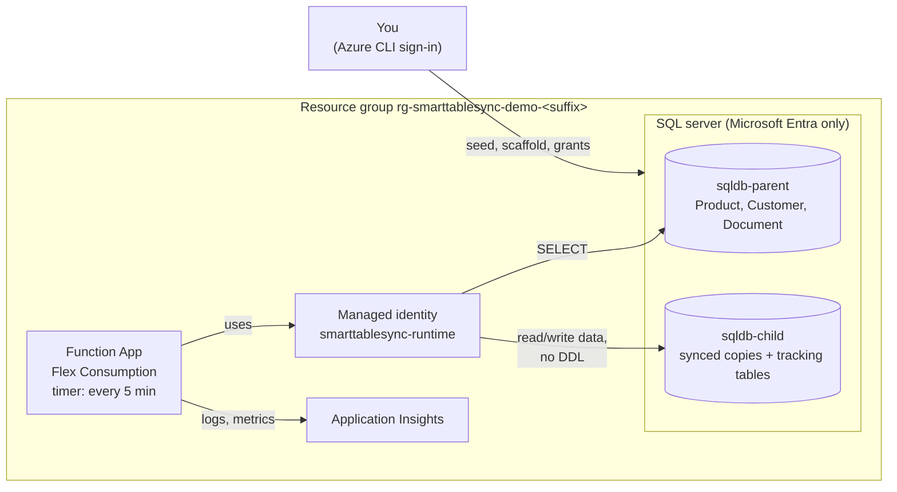

# SmartTableSync demo on Azure

One script deploys SmartTableSync to your own Azure subscription and shows a parent Azure SQL
database being synced into a child database: first a full copy, then inserts, updates and
deletes. It uses the same tools a real setup would: Terraform for the Azure resources,
`SmartTableSync.Scaffold` for the SQL, and a managed identity instead of passwords.

Everything is created in one resource group and removed again with `-Destroy`.

The demo is the [setup guide](../docs/setup.md) performed by a script. The guide's
[last section](../docs/setup.md#the-demo-as-a-worked-example) maps each demo step to its guide
step, and [From the demo to your own tables](#from-the-demo-to-your-own-tables) below lists what
changes for a real setup.

## What gets created



| Resource | Size | Cost while the demo exists |
|---|---|---|
| SQL server + 2 databases | Serverless, 0.5-1 vCore, pause after 1 hour idle | cents per hour while active, storage only while paused |
| Function App | Flex Consumption | the run volume stays in the monthly free grant |
| Storage account, Application Insights, Log Analytics | Standard / pay per GB | cents |

Prices are list prices; check the [Azure pricing calculator](https://azure.microsoft.com/pricing/calculator/)
for your region.

## The demo tables

Each table is shaped so SmartTableSync picks a different strategy for it by itself; no setting
tells it which one to use.

| Table | Rows | Shape | Change detection | Merge |
|---|---|---|---|---|
| `Product` | 2,000 | Change Tracking enabled | `SqlChangeTracking` | TVP batches |
| `Customer` | 1,000 | `rowversion` column | `RowVersion` | TVP batches |
| `Document` | 40 | `LastUpdate` column, composite key, three rows of 1.5 MB | `Timestamp` | row by row (large rows) |

## Prerequisites

- An Azure subscription where you can create resource groups, and a Microsoft Entra account
  that can be the SQL server's admin
- [Azure CLI](https://learn.microsoft.com/cli/azure/install-azure-cli), signed in:
  `az login`, then `az account set --subscription <id>`
- [Terraform](https://developer.hashicorp.com/terraform/install) 1.5 or later
- [go-sqlcmd](https://learn.microsoft.com/sql/tools/sqlcmd/go-sqlcmd-utility) (`winget install sqlcmd`).
  The older ODBC `sqlcmd` that ships with SQL Server can't sign in with your Azure CLI identity;
  the script checks which one it finds.
- [.NET 10 SDK](https://dotnet.microsoft.com/download) and
  [Azure Functions Core Tools v4](https://learn.microsoft.com/azure/azure-functions/functions-run-local)
- PowerShell 7.2 or later

## Run it

From the repository root:

```powershell
./demo/run-demo.ps1 -Suffix abc12 -SqlAdminLogin you@contoso.com
```

`-Suffix` makes the global names unique (3-8 lowercase letters or digits). The script shows
the subscription it's about to use and asks before creating anything; Terraform then shows its
plan and asks again. Optional: `-Location` (default `swedencentral`) and `-ClientIp` (your
public IP for the SQL firewall; detected when not given).

It takes about 10-15 minutes and runs six steps:

1. **Terraform** creates the resources above.
2. **Parent**: creates and seeds the demo tables (`sql/01_parent_schema.sql`) and gives the
   runtime identity read access (`sql/02_parent_grants.sql`).
3. **Change Tracking**: `SmartTableSync.Scaffold --change-tracking-setup Product` generates
   the script that enables it, and the script applies it to the parent.
4. **Child**: Scaffold generates the tracking tables, the synced tables, the table types and
   the merge procedures into `demo/generated/`; they're applied to the child, and the runtime
   identity gets data access without DDL rights (`sql/03_child_grants.sql`).
5. **Publish**: the Function is published from source (`SmartTableSyncFunction`).
6. **Sync**: the script triggers the Function once, instead of waiting for its 5-minute
   timer, and compares row counts and checksums of every table in both databases
   (`sql/05_table_fingerprints.sql`) until they match. Then it shows what SmartTableSync
   decided and recorded (`sql/06_child_sync_status.sql`).

## Watch changes arrive

```powershell
./demo/run-demo.ps1 -Suffix abc12 -SqlAdminLogin you@contoso.com -Changes
```

This inserts, updates and deletes rows in all three parent tables (`sql/04_parent_changes.sql`),
triggers a sync and compares again. You can run it as often as you like.

Inserts and updates arrive on the next run for every table. **Deletes** show the difference
between the strategies:

- `Product` (Change Tracking): Change Tracking records deletes, so they arrive on the next run.
- `Customer` (RowVersion) and `Document` (Timestamp): a deleted row leaves nothing to detect, so
  SmartTableSync finds deletes by comparing keys, the *delete reconciliation*. It runs on a
  fresh Function instance's first sync and then every hour (`SmartTableSync:ReconcileIntervalHours`).
  Until then the script reports those two tables as not matching yet.

To look around yourself, connect with SSMS or Azure Data Studio to the server name from
`terraform -chdir=demo/terraform output sql_server_fqdn`, using Microsoft Entra authentication.
Logs and the `smarttablesync.*` metrics are in the Application Insights resource.

## From the demo to your own tables

The demo keeps everything to one person and one script. For your own databases, follow the
[setup guide](../docs/setup.md); the differences are:

| In the demo | In a real setup |
|---|---|
| You run the scaffold tool and apply its SQL as the SQL server's Entra admin | The scaffold tool uses the **parent-introspection** identity; child scripts are applied by the **child-provisioning** identity; parent scripts (Change Tracking, rowversion) by a DBA |
| `sql/02_parent_grants.sql` and `sql/03_child_grants.sql` grant the runtime identity on the demo tables | The same grants for your tables, as in [`sql/07_permissions.sql`](../sql/07_permissions.sql) and the guide's rights table |
| Terraform creates new databases and fills the parent | Your parent and child already exist; only the Function, its identity and monitoring are new |
| Firewall allows Azure services | VNet integration and a private endpoint |
| The script triggers each sync | The 5-minute timer does |

The runtime identity's rights are the same in both: in the parent, read access to the synced
tables plus the metadata needed to profile them; in the child, data access, `EXECUTE` on the
merge procedures and their table types, and no DDL.

## Remove it

```powershell
./demo/run-demo.ps1 -Suffix abc12 -SqlAdminLogin you@contoso.com -Destroy
```

## Notes

- The SQL firewall allows Azure services, because a Flex Consumption app has no fixed outbound
  IP without a virtual network, plus the IP of the machine running the script. A production
  setup would use VNet integration and a private endpoint.
- The Function uses a user-assigned managed identity named `smarttablesync-runtime`, the name
  the repository's grant scripts use. Azure SQL creates the database user from the identity's
  display name, so it must be unique in your Microsoft Entra tenant.
- The demo tables have no `IDENTITY` columns: copying identity values (bulk copy with
  `KeepIdentity`) needs `ALTER` on the child table, which the runtime identity doesn't have.
- Terraform state stays on your machine in `demo/terraform/` and is git-ignored. Keep it until
  you've run `-Destroy`.
