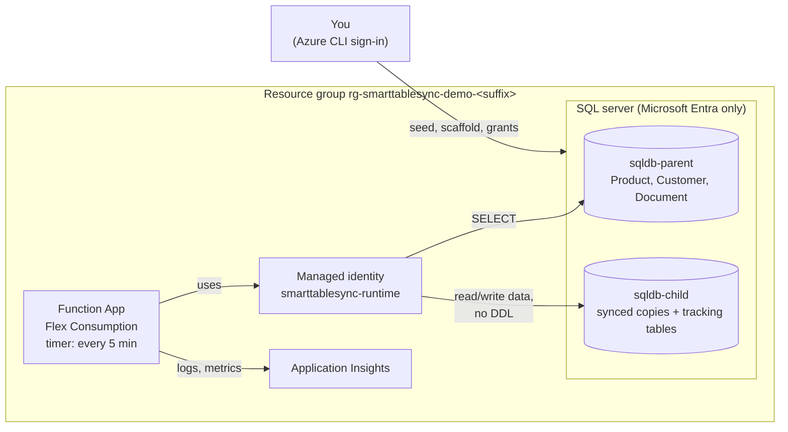

# SmartTableSync demo on Azure

One script deploys SmartTableSync to your own Azure subscription and shows a parent Azure SQL
database being synced into a child database: first a full copy, then inserts, updates and
deletes. It uses the same tools a real setup would: Terraform for the Azure resources,
`SmartTableSync.Scaffold` for the SQL, and a managed identity instead of passwords.

Everything is created in one resource group and removed again with `-Destroy`.

The demo is the [setup guide](../docs/setup.md) performed by a script. The guide's
[last section](../docs/setup.md#the-demo-as-a-worked-example) maps each demo step to its guide
step, and [From the demo to your own tables](#from-the-demo-to-your-own-tables) below lists what
changes for a real setup.

## What gets created



| Resource | Size | Cost while the demo exists |
|---|---|---|
| SQL server + 2 databases | Serverless, 0.5-1 vCore, pause after 1 hour idle | cents per hour while active, storage only while paused |
| Function App | Flex Consumption | the run volume stays in the monthly free grant |
| Storage account, Application Insights, Log Analytics | Standard / pay per GB | cents |

Prices are list prices; check the [Azure pricing calculator](https://azure.microsoft.com/pricing/calculator/)
for your region.

## The demo tables

Each table is shaped so SmartTableSync picks a different strategy for it by itself; no setting
tells it which one to use.

| Table | Rows | Shape | Change detection | Merge |
|---|---|---|---|---|
| `Product` | 2,000 | Change Tracking enabled | `SqlChangeTracking` | TVP batches |
| `Customer` | 1,000 | `rowversion` column | `RowVersion` | TVP batches |
| `Document` | 40 | `LastUpdate` column, composite key, three rows of 1.5 MB | `Timestamp` | row by row (large rows) |

## Run it, step by step

### Step 1. Check what you need

- **An Azure subscription** where your account can create resource groups and assign roles:
  Owner, or Contributor plus User Access Administrator. (Terraform gives the Function's identity
  a role on its storage account.)
- **These tools**, installed:
  - [Azure CLI](https://learn.microsoft.com/cli/azure/install-azure-cli)
  - [Terraform](https://developer.hashicorp.com/terraform/install) 1.5 or later
  - [go-sqlcmd](https://learn.microsoft.com/sql/tools/sqlcmd/go-sqlcmd-utility) (`winget install sqlcmd`).
    The older ODBC `sqlcmd` that ships with SQL Server can't sign in with your Azure account; the
    script checks which one it finds.
  - [.NET 10 SDK](https://dotnet.microsoft.com/download)
  - [Azure Functions Core Tools v4](https://learn.microsoft.com/azure/azure-functions/functions-run-local)
  - PowerShell 7.2 or later (`pwsh`)

### Step 2. Sign in to Azure and choose the subscription

The demo has no settings file for the subscription or the account: it uses whatever you're
signed in with in Azure CLI.

```powershell
az login
```

```powershell
az account list --output table
```

```powershell
az account set --subscription "<subscription name or id from the list>"
```

Check the result: this shows the subscription and the account the demo will use.

```powershell
az account show --query "{subscription:name, id:id, account:user.name}" --output table
```

That account becomes the **admin of the demo's SQL server**, and every SQL script the demo runs
uses it, with no passwords.

### Step 3. Choose a suffix

Azure needs globally unique names for the SQL server and the Function App, so the demo adds a
suffix of your choice to them: **3-8 lowercase letters or digits**, for example your initials
and a number (`rs01`). Use the same suffix for every later command of this demo.

### Step 4. Run the script

From the repository root, with your suffix in place of `rs01`:

```powershell
./demo/run-demo.ps1 -Suffix rs01
```

The script asks twice before it creates anything:

1. It shows what it will use and asks *"Create the demo resources in this subscription?"*.
   Type `y` if the subscription and account are right. Anything else cancels, and you can go
   back to step 2.

   ```text
   Subscription : <your subscription> (<id>)
   Signed in as : <your account>
   SQL admin    : <your account>
   Region       : swedencentral
   Client IP    : <your public IP> (allowed through the SQL firewall)
   ```

2. Terraform shows the resources it will create and asks *"Do you want to perform these
   actions?"*. Type `yes`.

Optional parameters, all with sensible defaults:

| Parameter | Default | Change it when |
|---|---|---|
| `-Location` | `swedencentral` | you want another Azure region, for example `-Location westeurope` |
| `-SqlAdminLogin` | the account you're signed in with | rarely: it must be that same account, because Terraform takes the admin's identity from your sign-in |
| `-ClientIp` | detected | your public IP can't be detected, or the SQL firewall should allow another IP |

### Step 5. Wait for it to finish

It takes about 10-15 minutes and runs six steps:

1. **Terraform** creates the resources above.
2. **Parent**: creates and seeds the demo tables (`sql/01_parent_schema.sql`) and gives the
   runtime identity read access (`sql/02_parent_grants.sql`).
3. **Change Tracking**: `SmartTableSync.Scaffold --change-tracking-setup Product` generates
   the script that enables it, and the script applies it to the parent.
4. **Child**: Scaffold generates the tracking tables, the synced tables, the table types and
   the merge procedures into `demo/generated/`; they're applied to the child, and the runtime
   identity gets data access without DDL rights (`sql/03_child_grants.sql`).
5. **Publish**: the Function is published from source (`SmartTableSyncFunction`).
6. **Sync**: the script triggers the Function once, instead of waiting for its 5-minute
   timer, and compares row counts and checksums of every table in both databases
   (`sql/05_table_fingerprints.sql`) until they match. Then it shows what SmartTableSync
   decided and recorded (`sql/06_child_sync_status.sql`).

When it's done you see a table with one row per demo table and `Match` = `True`, then the
strategy SmartTableSync picked for each one, and the commands for the next steps.

If a step fails, the script stops and shows the error. Fix the cause and run the same command
again: every step can be repeated safely.

## Watch changes arrive

```powershell
./demo/run-demo.ps1 -Suffix rs01 -Changes
```

This inserts, updates and deletes rows in all three parent tables (`sql/04_parent_changes.sql`),
triggers a sync and compares again. You can run it as often as you like. To make your own
changes instead, see [Change data yourself and check](#change-data-yourself-and-check).

Inserts and updates arrive on the next run for every table. **Deletes** show the difference
between the strategies:

- `Product` (Change Tracking): Change Tracking records deletes, so they arrive on the next run.
- `Customer` (RowVersion) and `Document` (Timestamp): a deleted row leaves nothing to detect, so
  SmartTableSync finds deletes by comparing keys, the *delete reconciliation*. It runs on a
  fresh Function instance's first sync and then every hour (`SmartTableSync:ReconcileIntervalHours`).
  Until then the script reports those two tables as not matching yet.

## Change data yourself and check

You can change the parent tables by hand and watch the changes reach the child.

**1. Connect to the databases.** Get the server name:

```powershell
terraform -chdir=demo/terraform output -raw sql_server_fqdn
```

Connect to it with SSMS, Azure Data Studio or VS Code's SQL extension, using **Microsoft Entra**
authentication (in SSMS: *Microsoft Entra MFA*) with the same account you ran the demo with. That
account is the server's admin, and the SQL firewall already allows your IP. You'll see two
databases: `sqldb-parent` (change data here) and `sqldb-child` (the copy, don't change it).

**2. Change rows in `sqldb-parent`.** Some examples, one per table:

```sql
-- Product (Change Tracking): any insert, update or delete is picked up
UPDATE dbo.Product SET Price = 99.95 WHERE ProductId = 1;

-- Customer (RowVersion): any insert or update is picked up; RowVer changes by itself
UPDATE dbo.Customer SET City = N'Stockholm' WHERE CustomerId = 1;

-- Document (Timestamp): an update is picked up ONLY if LastUpdate moves too, in UTC
UPDATE dbo.Document SET Title = N'Edited by hand', LastUpdate = GETUTCDATE()
WHERE DocumentId = 1 AND LanguageCode = N'en';
```

**3. Sync.** Wait for the Function's timer (at most 5 minutes), or sync right away:

```powershell
./demo/run-demo.ps1 -Suffix rs01 -SyncNow
```

It triggers one sync, compares row counts and checksums of all three tables in both databases
until they match, and shows what SmartTableSync recorded.

**4. Check.** In `sqldb-child`, query the same rows and see the new values:

```sql
SELECT Price FROM dbo.Product WHERE ProductId = 1;
SELECT City FROM dbo.Customer WHERE CustomerId = 1;
SELECT Title, LastUpdate FROM dbo.Document WHERE DocumentId = 1 AND LanguageCode = N'en';
SELECT TableName, LastSyncDate, IncrementalPosition FROM dbo.CustomSyncState;   -- where each table got to
```

Things that look wrong but aren't:

| What you see | Why |
|---|---|
| A `Document` update doesn't arrive | It didn't change `LastUpdate`. The Timestamp strategy only sees rows whose `LastUpdate` moved |
| A deleted `Customer` or `Document` row is still in the child | Those strategies find deletes by comparing keys, which runs on a fresh Function instance's first sync and then hourly. `Product` deletes arrive on the next run |
| A row you changed in `sqldb-child` was overwritten | The child is a read-only copy: every sync makes it match the parent again |

Logs and the `smarttablesync.*` metrics are in the demo's Application Insights resource.

## Where the demo's settings are

The demo sets no strategy anywhere. SmartTableSync picks each table's strategy itself, from the
table's shape:

| Table | Picks | Because of | Set up in |
|---|---|---|---|
| `Product` | `SqlChangeTracking` | Change Tracking is enabled on it | step 3 of the script (the scaffold tool's `--change-tracking-setup Product` script) |
| `Customer` | `RowVersion` | it has a `rowversion` column | `sql/01_parent_schema.sql` |
| `Document` | `Timestamp` | it has a `LastUpdate` column | `sql/01_parent_schema.sql` |

The Function's settings are in `terraform/functions.tf` (`app_settings`). Terraform writes them
to the Function App when it creates it:

| Setting | Value in the demo |
|---|---|
| `ParentDbConnectionString`, `ChildDbConnectionString` | built by Terraform, see below |
| `SmartTableSync__TableList` | `Product,Customer,Document` (the `table_list` variable in `terraform/variables.tf`) |
| `SmartTableSync__Mode` | `Manual`: the child's objects come from the scaffold tool's scripts |

On Linux a setting name can't contain `:`, so `SmartTableSync:TableList` is written
`SmartTableSync__TableList`. To try another setting, add it to `app_settings` and run the setup
command again: it repeats every step safely, and Terraform changes only the Function's settings. For example, to force `Customer`
onto the Timestamp strategy: `SmartTableSync__IncrementalStrategyOverrides__Customer = "Timestamp"`.
Because `Customer` is already set up, that takes effect only after you
[reset its plan](../docs/how-it-works.md#changing-a-tables-strategy-later). Every setting is
listed in the README's [Configuration](../README.md#configuration) section, and what the sync
decided per table is in the child's `dbo.SyncTableConfig`.

## How the Function connects to the databases

No password or connection string is typed anywhere:

1. **Terraform builds the connection strings** from the resources it creates (`terraform/functions.tf`):
   the SQL server's name, the database name, `Authentication=Active Directory Managed Identity`,
   and `User Id=` the client ID of the `smarttablesync-runtime` identity. It stores them in the
   Function App's settings.
2. **SmartTableSync reads them** by name from the host's configuration (`ParentDbConnectionString`,
   `ChildDbConnectionString`) and opens a new connection per table on every run.
3. **Signing in:** SqlClient asks the Function's managed identity for a token and signs in to
   Azure SQL with it. Azure SQL maps the token to the database user `[smarttablesync-runtime]`,
   which the demo's grant scripts created (`sql/02_parent_grants.sql`, `sql/03_child_grants.sql`).
   So the Function has exactly those rights.

The script itself, the SQL steps and the scaffold tool connect as **you**, through your Azure CLI
sign-in (`Authentication=Active Directory Default`); you're the server's admin.

## From the demo to your own tables

The demo keeps everything to one person and one script. For your own databases, follow the
[setup guide](../docs/setup.md); the differences are:

| In the demo | In a real setup |
|---|---|
| You run the scaffold tool and apply its SQL as the SQL server's Entra admin | The scaffold tool uses the **parent-introspection** identity; child scripts are applied by the **child-provisioning** identity; parent scripts (Change Tracking, rowversion) by a DBA |
| `sql/02_parent_grants.sql` and `sql/03_child_grants.sql` grant the runtime identity on the demo tables | The same grants for your tables, as in [`sql/07_permissions.sql`](../sql/07_permissions.sql) and the guide's rights table |
| Terraform creates new databases and fills the parent | Your parent and child already exist; only the Function, its identity and monitoring are new |
| Firewall allows Azure services | VNet integration and a private endpoint |
| The script triggers each sync | The 5-minute timer does |

The runtime identity's rights are the same in both: in the parent, read access to the synced
tables plus the metadata needed to profile them; in the child, data access, `EXECUTE` on the
merge procedures and their table types, and no DDL.

## Remove it

With the same suffix as the setup:

```powershell
./demo/run-demo.ps1 -Suffix rs01 -Destroy
```

Terraform lists what it will delete and asks you to type `yes`.

## Notes

- The SQL firewall allows Azure services, because a Flex Consumption app has no fixed outbound
  IP without a virtual network, plus the IP of the machine running the script. A production
  setup would use VNet integration and a private endpoint.
- The Function uses a user-assigned managed identity named `smarttablesync-runtime`, the name
  the repository's grant scripts use. Azure SQL creates the database user from the identity's
  display name, so it must be unique in your Microsoft Entra tenant.
- Terraform state stays on your machine in `demo/terraform/` and is git-ignored. Keep it until
  you've run `-Destroy`.
