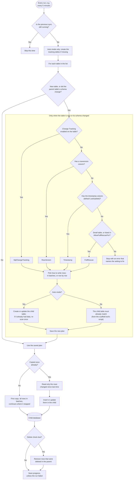

# How a sync run works, in detail

The [README](../README.md#how-it-works) shows the short version. This page shows every step of
one run, and where each step lives in the code.

## The steps

1. **Previous sync still running.** Only one sync may work on a child database at a time, even
   with several host instances. A run that finds another one busy does nothing.
2. **New table, or did the schema change.** The parent table's schema (columns and their types,
   primary key, identity column, and whether Change Tracking is on) is compared with what was
   seen last time. Usually nothing changed, and the saved plan is used as it is. Settings are not
   part of this check; see [changing a table's strategy later](#changing-a-tables-strategy-later).
3. **Pick how to find changes.** Only for a new table or a changed schema. The four checks run in
   this order and the first match wins. "Small" means 50,000 rows or fewer, counted at this
   moment. To choose a strategy yourself, set `SmartTableSync:IncrementalStrategyOverrides:<Table>`;
   it still has to fit the table, or this step fails. Each strategy is explained, with a
   diagram, in [how SmartTableSync finds what changed](sync-strategies.md).
4. **Pick how to write rows.** In batches through one stored-procedure call, or row by row for
   tables that reference other tables or have rows over about 1 MB. See
   [merge strategies](../README.md#merge-strategies).
5. **Make the child table match.**
   - **Auto mode:** SmartTableSync creates the child table, or adds the new columns. If the table
     already had data, it then reads the whole table once, so existing rows get the new values. A
     brand-new table skips this: it gets its first copy instead.
   - **Manual mode:** nothing is changed in the child. You create or update the child objects
     from the scaffold tool's scripts. The new plan is saved right away, so apply those scripts
     together with the parent change: until they are applied, that table's sync can fail. See
     the [setup guide](setup.md#manual-or-auto-mode).
6. **First copy.** A new table is copied in batches, in key order, with bulk copy. If a run stops
   halfway, the next run continues from the last batch that finished.
7. **Rows changed since last time.** After the first copy, each run reads only the changed rows,
   using the strategy picked in step 3, and inserts or updates them in the child.
8. **Delete check.** RowVersion, Timestamp and FullRescan can't see deletes, so the parent's keys
   are compared with the child's and missing rows are removed. This runs at most once an hour
   per host process (`SmartTableSync:ReconcileIntervalHours`), and also on the first run after
   the host starts, because the time of the last check is kept in memory. Change Tracking
   reports deletes itself, so for those tables the check runs once a day as a safety net
   (`SmartTableSync:ChangeTrackingReconcileIntervalHours`).
9. **Save progress.** Where the run got to is saved when the run succeeds. If a table's run
   fails, the error is logged and the next run starts that table from the same place again; the
   other tables carry on. A row that failed only because the row it references hadn't arrived
   yet also holds progress back, so it is retried. Any other row that can't be written is logged
   and skipped.

## Changing a table's strategy later

The strategy is picked once, when the table is set up, and saved in the child's
`dbo.SyncTableConfig` table. It is picked again only when the parent table's schema changes.
Changing `IncrementalStrategyOverrides`, `TimestampColumns` or `AllowFullRescanFor` for a table
that is already set up has no effect on its own, and a table that grows past 50,000 rows keeps
its full re-scan.

To make the engine pick again, delete that table's row from `dbo.SyncTableConfig` in the child
(as an administrator; the runtime identity can't delete there). The next run picks the strategy
with the current settings and saves it. Data already in the child stays. If the new strategy is
RowVersion or Change Tracking, its first run reads the whole table once, because there is no
saved position for it yet.

## Where each step lives in the code

| Step | Code |
|---|---|
| Previous sync still running | `ChildDatabaseRunLock` (`sp_getapplock` on the child) plus an in-process lock in `SyncOrchestrator` |
| Tracking tables (Auto mode) | `ChildDdlProvisioner.EnsureInfrastructureExistsAsync` |
| New table or changed schema | `SchemaReader` and `SchemaFingerprint`, used by `SyncTableProvisioner.PlanAsync` |
| Pick how to find changes | `SyncPlanHeuristic.SelectIncrementalStrategy`, in the order of `IncrementalStrategies.All` |
| Pick how to write rows | `SyncPlanHeuristic` (row-size threshold `LargeRowThresholdBytes`, 1 MB) |
| Make the child table match | `ChildDdlProvisioner` and `ChildSchemaComparer` (Auto), or the scaffold tool (Manual) |
| Save the new plan | `SyncTableProvisioner.SaveAsync`, into `dbo.SyncTableConfig` |
| First copy | `InitialSyncRunner`: `SqlBulkCopy` in key order, resume key in `dbo.SyncBatchLog` |
| Rows changed since last time | the runners under `Strategies/`, all based on `ChangeWindowSyncRunner` |
| Insert or update | `MERGE` through a table-valued parameter, or row by row |
| Delete check | delete reconciliation; settings `SmartTableSync:ReconcileIntervalHours` and `SmartTableSync:ChangeTrackingReconcileIntervalHours` |
| Save progress | `dbo.CustomSyncState` |
