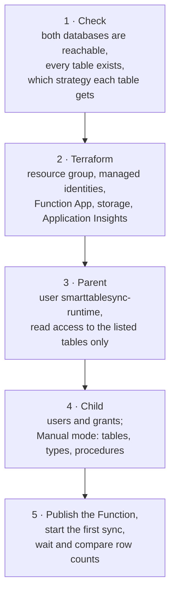

# Quick start on your own databases

One script that starts syncing tables from a parent database you already have into a child
database you already have, both on Azure SQL Database. It creates the Azure Function that runs
the sync, its managed identities, the database users with exactly the rights they need, and runs
the first sync.

The [demo](../demo/README.md) is different: it creates its own SQL server, databases and demo
tables. Use the demo to see SmartTableSync work; use this quick start for your own tables.

```powershell
./quickstart/deploy.ps1 -Suffix acme1 `
    -ParentServer myserver.database.windows.net -ParentDatabase SalesDb `
    -ChildDatabase SalesCopy `
    -Tables "Product,Customer,sales.Order"
```

A few minutes later the child has a copy of the three tables, and the Function keeps it up to date
every 5 minutes.

## Contents

- [What you need](#what-you-need)
- [Step by step](#step-by-step)
- [What the script does](#what-the-script-does)
- [Identities, database users and their rights](#identities-database-users-and-their-rights)
- [Connection strings](#connection-strings)
- [Auto or Manual mode](#auto-or-manual-mode)
- [After the setup](#after-the-setup)
- [Removing it](#removing-it)
- [Troubleshooting](#troubleshooting)
- [Limits of the quick start](#limits-of-the-quick-start)

## What you need

**On your machine**

| Tool | Why |
|---|---|
| PowerShell 7.2+ | runs the script |
| [Azure CLI](https://learn.microsoft.com/cli/azure/install-azure-cli), signed in (`az login`, `az account set --subscription <id>`) | the subscription the Function is created in, and your sign-in for SQL |
| [Terraform](https://developer.hashicorp.com/terraform/install) 1.5+ | creates the Azure resources |
| [go-sqlcmd](https://learn.microsoft.com/sql/tools/sqlcmd/go-sqlcmd-utility) (`winget install sqlcmd`) | runs the SQL as you; the older ODBC `sqlcmd` can't sign in with Azure CLI |
| [.NET 10 SDK](https://dotnet.microsoft.com/download) and [Azure Functions Core Tools v4](https://learn.microsoft.com/azure/azure-functions/functions-run-local) | build and publish the Function |

**On the databases**

- Both are **Azure SQL Database** with **Microsoft Entra authentication** turned on. They can be
  on the same server or on two servers.
- **Your account** can create users and grant rights in both databases: the server's Microsoft
  Entra admin, or a member of `db_owner` in each database. With `-EnableChangeTracking` it also
  needs `ALTER` on the parent tables and the database.
- **Your IP address** is allowed through both servers' firewalls, because the script connects
  from your machine.
- **The Function can reach both servers**: "Allow Azure services and resources to access this
  server" is on in each server's *Networking* page, or the Function is connected to their virtual
  network (not set up by this script). The script checks this for servers in your subscription.
- Each table has a **primary key**, or a unique index whose columns are all `NOT NULL`.

## Step by step

1. **Sign in** to the subscription the Function should go into:

   ```powershell
   az login
   az account set --subscription "<subscription name or id>"
   ```

2. **Try a dry run.** It only reads both databases, writes the SQL it would run to
   `quickstart/generated/<suffix>/`, and shows Terraform's plan. Nothing is created or changed.

   ```powershell
   ./quickstart/deploy.ps1 -Suffix acme1 -ParentServer myserver.database.windows.net `
       -ParentDatabase SalesDb -ChildDatabase SalesCopy -Tables "Product,Customer,sales.Order" -DryRun
   ```

   It shows which strategy each table will get:

   ```text
   Table        Rows Strategy          Note
   -----        ---- --------          ----
   Product      2300 SqlChangeTracking Change Tracking is on
   Customer     1300 RowVersion        has a rowversion column
   sales.Order    64 Timestamp         LastUpdate column (must hold UTC time)
   ```

   A table marked `NO KEY` or `BLOCKED` won't sync until you fix what its note says; the others
   are not affected.

3. **Run the setup**: the same command without `-DryRun`. It asks once before creating anything,
   and Terraform shows its plan and asks again.

4. **Check the result.** The script waits for the first copy and shows, per table, the row count
   in the parent and in the child, then the strategy SmartTableSync chose. For changes made after
   that:

   ```powershell
   ./quickstart/deploy.ps1 -Suffix acme1 -SyncNow
   ```

### Parameters

| Parameter | Required | Meaning |
|---|---|---|
| `-Suffix` | yes | 3-8 lowercase letters or digits, part of every Azure name. Use the same one for `-SyncNow` and `-Destroy`. |
| `-ParentServer` | yes | parent server host name, e.g. `myserver.database.windows.net` |
| `-ParentDatabase` | yes | parent database |
| `-ChildServer` | no | child server; the parent's server when left out |
| `-ChildDatabase` | yes | child database. It must exist; it may be empty. |
| `-Tables` | yes | comma-separated: `Customer` for `dbo.Customer`, `sales.Order` for another schema |
| `-Mode` | no | `Auto` (default) or `Manual`, see [below](#auto-or-manual-mode) |
| `-EnableChangeTracking` | no | turns on Change Tracking in the parent for the listed tables that have a primary key |
| `-Location` | no | Azure region for the Function, default `swedencentral`. Use the databases' region. |
| `-DryRun` | no | check and show only, change nothing |
| `-SyncNow` | no | start a sync now and wait for it, after the setup |
| `-Destroy` | no | remove the Azure resources |
| `-SyncTimeoutSeconds` | no | how long to wait for the first copy, default 600 |
| `-Yes` | no | skip the script's own "Create …?" question. Terraform still shows its plan and asks you to confirm it. |

## What the script does



| Step | Runs as | Creates or changes |
|---|---|---|
| 1. Check | you | nothing; reads table definitions and sizes |
| 2. Terraform | you (Azure CLI) | in a new resource group `rg-smarttablesync-qs-<suffix>`: the runtime identity, the provisioning identity (Auto mode), the Function App `func-smarttablesync-qs-<suffix>` (Flex Consumption), its storage account, Log Analytics and Application Insights. **Never** your servers or databases. |
| 3. Parent | you (SQL) | the database user `smarttablesync-runtime` and its grants; with `-EnableChangeTracking`, Change Tracking on the tables |
| 4. Child | you (SQL) | the database users and their grants; in Auto mode, any missing schema for the listed tables; in Manual mode, also the tracking tables, the synced tables, table types and merge procedures from the scaffold tool |
| 5. Publish and sync | you, then the Function | the Function's code; the first sync, which in Auto mode creates the child's tables |

Every SQL script is written to `quickstart/generated/<suffix>/` **before** it runs, so you can see
exactly what was applied:

| File | Database | Content |
|---|---|---|
| `01_parent.sql` | parent | runtime user, read grants, Change Tracking (if asked) |
| `02_child.sql` | child | Auto mode: both users, `db_ddladmin`, schema grants |
| `child/*.sql` | child | Manual mode: the scaffold tool's scripts |
| `03_child_grants.sql` | child | Manual mode: runtime user and per-object grants |
| `quickstart.tfvars.json` | — | your parameters, read again by `-SyncNow` and `-Destroy` |

The script never deletes anything from your databases, and every SQL script is safe to run again.
Running the whole setup again with the same suffix updates what changed (for example a longer
table list) and leaves the rest as it is.

## Identities, database users and their rights

SmartTableSync never uses a password here. The Function signs in to SQL with **managed
identities**, Microsoft Entra identities that Azure manages for it. The script creates a database
user for each of them, tied to the identity by its ID (`CREATE USER … WITH SID = …, TYPE = E`), so
the database user names are always the same, whatever the identities are called in Azure:

| Managed identity (Azure) | Database user | Used for |
|---|---|---|
| `id-smarttablesync-runtime-<suffix>` | `smarttablesync-runtime` | every sync: reads the parent, writes rows into the child |
| `id-smarttablesync-provisioning-<suffix>` (Auto mode only) | `smarttablesync-child-provisioning` | creating and changing the child's tables, table types and procedures |
| you | — | the setup itself: checks, users, grants, Change Tracking, Manual mode's scripts |

**Parent database** (both modes):

| User | Rights | Why |
|---|---|---|
| `smarttablesync-runtime` | `SELECT`, `VIEW DEFINITION` on each listed table | read the rows, and the table's columns and keys |
| | `VIEW DATABASE STATE` | read a table's row count and size when it's profiled |
| | `VIEW CHANGE TRACKING` on each table with Change Tracking | read the changes |

Nothing else: no other table, no write right, no DDL. SmartTableSync never changes the parent.

**Child database, Auto mode:**

| User | Rights | Why |
|---|---|---|
| `smarttablesync-child-provisioning` | member of `db_ddladmin` | create the tracking tables, the synced tables, their table types and procedures; add new columns later |
| `smarttablesync-runtime` | `SELECT, INSERT, UPDATE, DELETE, EXECUTE` on the schema of each synced table, and on `dbo` | write rows and run the merge procedures, including those created later. No DDL. |

Schema-wide rights are needed because the tables are created after the grants are given. They
reach every table in those schemas, so use a child database (or schemas) that only SmartTableSync
writes to.

**Child database, Manual mode:**

| User | Rights |
|---|---|
| `smarttablesync-runtime` | `SELECT, INSERT, UPDATE, DELETE` on each synced table; `SELECT, INSERT, UPDATE` on the three tracking tables; `EXECUTE` on each merge procedure and table type |

There is no provisioning identity in Manual mode: the child's objects come from the scaffold
tool's scripts, which the script applies as you.

These are the same rights as in [`sql/07_permissions.sql`](../sql/07_permissions.sql), which the
integration tests check by running syncs as each identity with exactly those grants.

## Connection strings

The quick start writes these as the Function's **app settings**; the sync engine reads them from
there, as it reads them from any host's settings (on Linux, `:` in a setting name is written `__`):

| Setting | Value |
|---|---|
| `ParentDbConnectionString` | `Server=tcp:<parent server>,1433;Database=<parent db>;Authentication=Active Directory Managed Identity;User Id=<runtime client id>;Encrypt=True` |
| `ChildDbConnectionString` | the same for the child, also as the runtime identity |
| `ChildProvisioningConnectionString` | Auto mode only: the child, as the provisioning identity |
| `SmartTableSync__TableList` | your `-Tables` |
| `SmartTableSync__Mode` | `Auto` or `Manual` |
| `APPLICATIONINSIGHTS_CONNECTION_STRING` | the Application Insights the script created |

`User Id` is the managed identity's client ID; it selects which of the Function's identities signs
in. There are no passwords or keys for SQL anywhere. Every other setting has its default; see the
[configuration reference](../docs/configuration.md) to change one.

**Already have connection strings?** You don't need the quick start: put them into your host's
settings under the same names (`ParentDbConnectionString`, `ChildDbConnectionString`, and in Auto
mode `ChildProvisioningConnectionString`), together with `SmartTableSync:TableList`. The engine
uses whatever sign-in they contain: a managed identity, a SQL login or Windows authentication.

## Auto or Manual mode

| | Auto (default) | Manual (`-Mode Manual`) |
|---|---|---|
| Who creates the child's tables | the Function, on its first run | this script, from the scaffold tool's scripts |
| A column added to the parent later | added by the Function on its next run | the table stops until you run the scaffold tool and apply `<Table>_AddColumns.sql` |
| Function's rights on the child | DDL through the provisioning identity; data rights on whole schemas | data rights on the synced objects only |
| Good for | a child database used only by SmartTableSync; trying it out | production with change control |

More about the difference: [Manual or Auto mode](../README.md#manual-or-auto-mode).

## After the setup

- **Logs:** the Function's *Log stream* in the portal, or Application Insights (`traces` and the
  `smarttablesync.*` metrics). See [logs and metrics](../docs/setup.md#logs-and-metrics).
- **Status in the child:** `dbo.SyncTableConfig` (strategy per table), `dbo.CustomSyncState`
  (where each table stopped), `dbo.SyncBatchLog` (first copies).
- **Add a table:** run the setup again with the longer `-Tables`. It grants read access to the
  new table and updates `SmartTableSync__TableList`.
- **Other settings** (timestamp column name, keys for a table without a primary key, delete check
  interval): add them as app settings on the Function; see the
  [configuration reference](../docs/configuration.md). Terraform keeps only the settings it manages,
  so add yours in the portal or with `az functionapp config appsettings set`, and add them again
  after a re-run of the setup.
- **Schedule:** the example Function runs every 5 minutes (`SmartTableSyncTimerFunction.cs`).
  Change it there and publish again, or host the engine yourself
  ([examples](../docs/guides/hosting.md)).
- **Deletes** in tables on RowVersion or Timestamp reach the child at the next delete check, not
  with the next sync: see [delete reconciliation](../docs/sync-strategies.md#delete-reconciliation).

## Removing it

```powershell
./quickstart/deploy.ps1 -Suffix acme1 -Destroy
```

Removes the resource group with the Function, identities, storage and monitoring. **Your databases
are not touched**: the synced tables stay in the child. The script writes
`quickstart/generated/<suffix>/99_drop_users.sql` with the `DROP USER` statements, for you to run
if you want the database users gone too. Once the identities are deleted, those users can't sign
in anyway.

## Troubleshooting

| Symptom | Cause and fix |
|---|---|
| *"The database user smarttablesync-runtime already exists for a different identity"* | That database is already used by another SmartTableSync setup, for example the demo. Remove that user (`DROP USER [smarttablesync-runtime]`) if the other setup is gone, or use another database. |
| The check fails with *"Login failed"* or a firewall message | Your IP isn't allowed through the server's firewall, or your account has no user in that database. |
| *"permission was denied"* while creating users | Your account isn't the server's Entra admin or `db_owner` in that database. |
| The setup finishes but no table syncs | The Function can't reach SQL: turn on "Allow Azure services and resources to access this server", then `-SyncNow`. The Log stream shows the exact error. |
| One table doesn't sync, the others do | Its error is in the Log stream. Common: no usable key (set `SmartTableSync:KeyColumns:<Table>`), a large table with no way to find changes, or (Manual mode) a parent column added after the setup. |
| *"Not every table has synced yet"* after the wait | A large first copy takes longer. Run `-SyncNow` later; the copy continues where it stopped. |

More in the setup guide's [troubleshooting](../docs/setup.md#troubleshooting).

## Limits of the quick start

- **Azure SQL Database with Microsoft Entra authentication only.** For SQL Server on-premises or
  in a VM, a Managed Instance, or SQL logins, follow the [setup guide](../docs/setup.md) and host
  the engine where it can reach your servers.
- **Public endpoints:** the Function reaches SQL over the internet through the "Allow Azure
  services" rule. For private endpoints, connect the Function to the virtual network yourself.
- **One child per parent per suffix.** Several quick starts can run side by side with different
  suffixes, but not into the same child database: the database user names are fixed.
- Settings beyond the table list and mode are added on the Function afterwards (see above).
